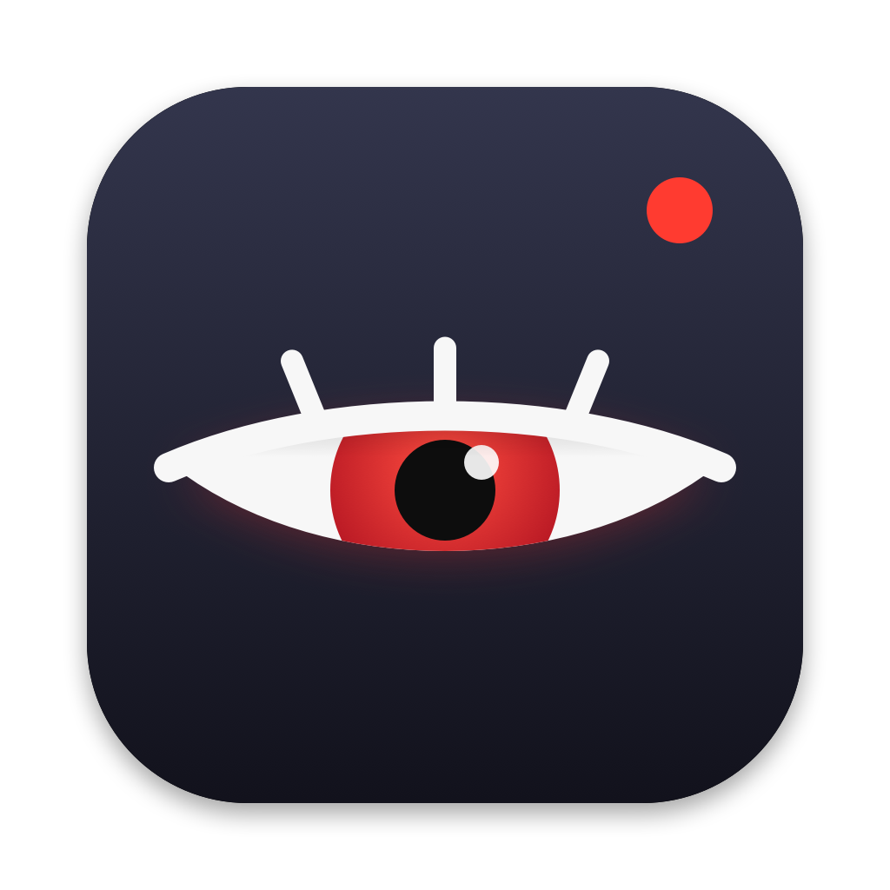

<h1 align="center">실눈 (Silnun)</h1>

자리를 비운 사이 누가 맥을 만지면, 전면 카메라로 찍는 메뉴바 앱

<a href="https://github.com/duaghwns/Silnun-releases/releases/latest"><b>⬇︎ 최신 버전 다운로드</b></a>

---

## 이렇게 동작해요

1. 잠깐 자리를 비울 때 `⌃⌥⌘L` — 메뉴바 눈이 실눈을 떴다가 번쩍 뜹니다.
2. 그 사이 누가 키보드·트랙패드·마우스를 만지면 2초 뒤 사진을 연속으로 찍습니다.
3. 돌아와서 `⌃⌥⌘U` 또는 Touch ID로 해제하면 눈을 감습니다.

## 기능

- **찍힌 사람에게** — 몰래 찍기 / 방금 찍힌 사진과 직접 쓴 경고 문구를 전체 화면에 보여주기
- **찍힌 뒤에** — 경보음, 경고 음성, 화면 잠금 (설정에서 켜고 끔)
- **폰 알림** — 텔레그램 봇 또는 ntfy 앱으로 사진 바로 받기
- 감시 중 맥이 잠들면(뚜껑 닫힘 등) 알림
- 단축키 변경, 준비·유예 시간, 마우스 이동 무시 등 세부 설정
- 사진은 내 맥(`~/Pictures/실눈`)에만 저장, 폰 알림을 켰을 때만 내가 정한 곳으로 전송

## 설치

1. [Releases](https://github.com/duaghwns/Silnun-releases/releases/latest)에서 `Silnun-x.y.z.dmg`를 받아 열고, **실눈**을 응용 프로그램 폴더로 끌어 넣습니다.
2. 처음 열 때 "확인되지 않은 개발자" 경고가 나오면
   **시스템 설정 → 개인정보 보호 및 보안** 맨 아래에서 **그래도 열기**를 누르세요.
   (Apple 공증 전이라 한 번만 필요합니다.)
3. 카메라 권한을 허용하면 끝.

macOS 14 이상 · Apple Silicon / Intel

## 알아두세요

- 카메라를 켜면 맥북의 초록 불이 켜집니다 (하드웨어라 끌 수 없어요).
- 뚜껑을 닫으면 촬영할 수 없습니다. 대신 폰으로 "잠자기 들어감" 알림을 보냅니다.
- 본인 기기를 지키는 용도로만 사용하세요.
